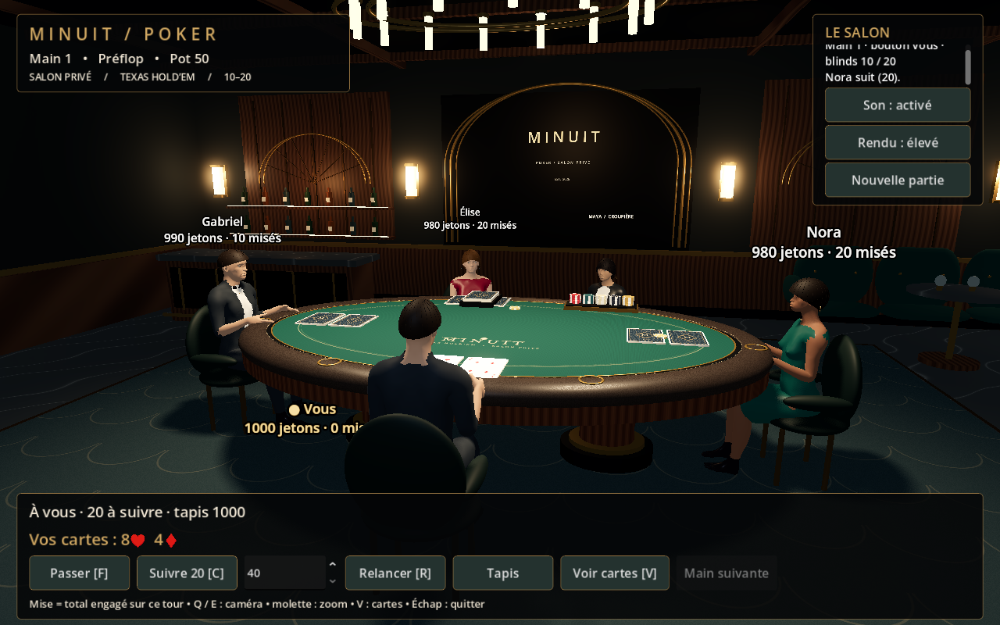
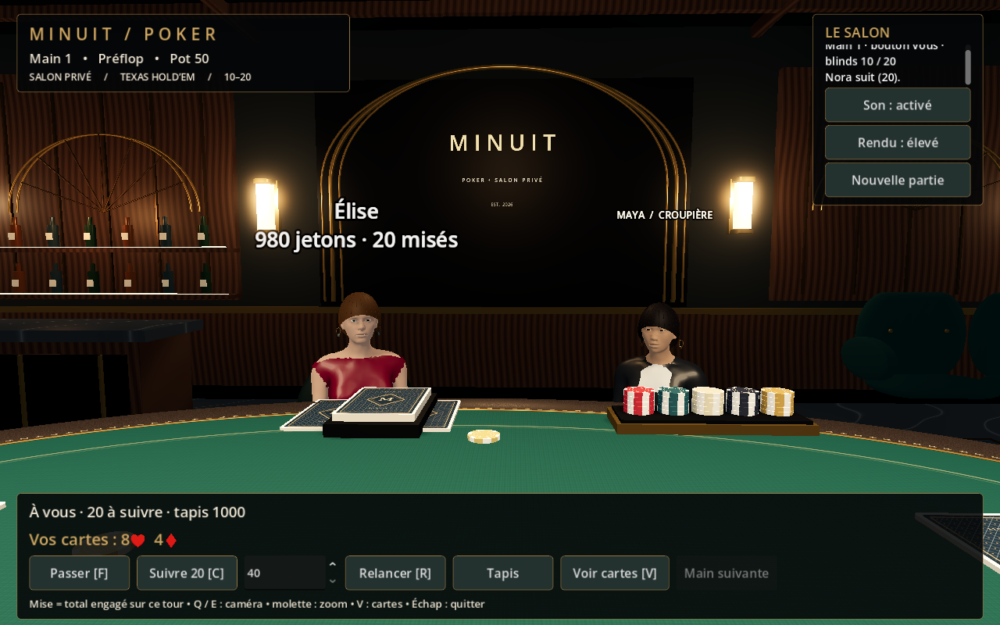

# Refonte visuelle — 25 octobre 2026

Cette révision remplace la présentation du premier prototype. Les captures ci-dessous proviennent du jeu Godot avec le rendu Forward+, exécuté sous Linux avec un pilote Vulkan logiciel. Ce sont des captures du projet livré, sans retouche et sans image conceptuelle générée.

## Comparaison

Avant :

Après :

Vue rapprochée de la table :

## Modifications

- Architecture Art déco : arche et reliefs, boiseries veinées, marbre, tapis à motifs, plafond, appliques, bar et banquette. Deux spots à ombres éclairent la table ; les éclairages secondaires donnent de la profondeur à la salle.
- Table reconstruite : rail en cuir arrondi, coutures regroupées dans un MultiMesh, acajou, cerclages en laiton, porte-gobelets, sabot et réserve de jetons.
- Jeu de cartes complet : 52 illustrations de rangs, enseignes et figures, dos original, maillages de papier arrondis et jetons à inserts. Les dessins SVG sont conservés ; le jeu utilise des PNG pour éviter les limitations de rendu SVG de Godot.
- Personnages : quatre maillages humains adultes, avec doigts et visages, préparés dans Blender à partir de données anatomiques CC0 MakeHuman. Vêtements de soirée, cheveux, yeux et accessoires. Animations squelettiques de repos et de distribution. Le joueur et Gabriel partagent le même modèle dans cette version.
- Caméra déplacée à l’épaule pour dégager le centre du tableau. Interface plus compacte, boutons conservant leurs raccourcis.
- Paramètres MSAA et taille des ombres replacés dans la bonne section de `project.godot` : ils étaient précédemment dans la section audio et ne s’appliquaient pas.

## État réel

Les proportions et la géométrie sont plus détaillées, mais les personnages gardent des matériaux simples. Ce ne sont pas encore des personnages photoréalistes : la peau, les coiffures et les vêtements nécessiteront encore du travail artistique. La salle et le mobilier restent des créations procédurales. Les règles et les décisions IA sont conservées.

Le projet fonctionne sans Blender : tous les GLB et toutes les textures sont inclus. Les sources et licences sont disponibles dans `assets/source/makehuman/` et `assets/table/licenses/`. Les outils de génération sont dans `tools/` et les données de fabrication sont exclues de l’export du jeu.

Les tests automatisés vérifient les règles, les cartes, les maillages, les clips d’animation et les commandes. Ils ne mesurent ni le réalisme artistique ni les performances sur la RTX 2070. Aucun test Windows matériel n’a été exécuté dans cet environnement Linux.
